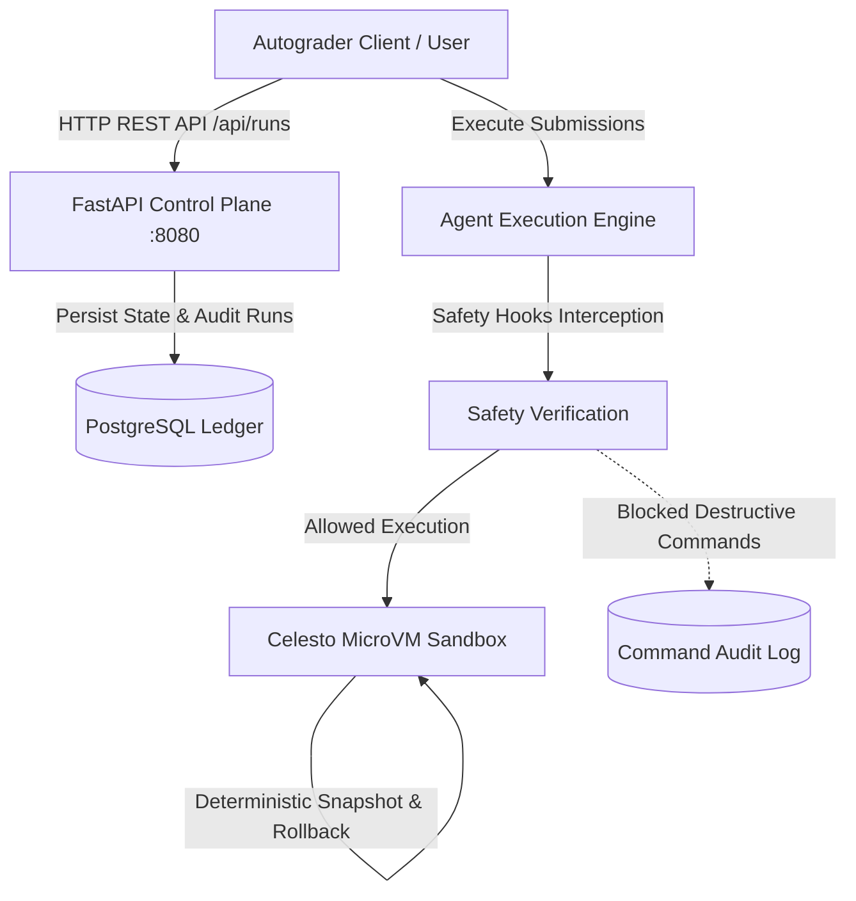

# Hostile Code Autograder

An enterprise-grade, hostile code autograding pipeline powered by Celesto microVMs and a hardened FastAPI + PostgreSQL control plane ledger.



> **Video Walkthrough:** The demonstration walkthrough video is located at `demo/walkthrough.mp4`.

---

## Problem statement

Automated grading of arbitrary programming assignments presents severe security, reliability, and isolation challenges:
1. **Hostile Code Submissions**: Submissions can attempt fork bombs, memory exhaustion, local file system corruption (`rm -rf /`), credential theft, or unauthorized network exfiltration.
2. **State Pollution**: Shared execution environments suffer from cross-test contamination where one submission mutates global environment variables, dependencies, or system files, skewing grading results for subsequent students.
3. **Container Escape Vulnerabilities**: Standard container runtimes (such as standard Docker) share the underlying host kernel, exposing the host system to potential privilege escalation and kernel exploit attacks.

The Hostile Code Autograder resolves these challenges by executing each grading job in hardware-isolated Celesto microVMs, enforcing strict safety hook validation, taking deterministic snapshots before untrusted evaluation, and maintaining an immutable ledger in PostgreSQL for run lifecycle tracking.

---

## How I used Celesto

Celesto provides microVM lifecycle control with near-instant boot times and microVM isolation. In this autograder architecture, Celesto is leveraged for:

1. **MicroVM Sandbox Lifecycle Management**:
   Every submission is provisioned with a uniquely identified sandbox following the strict specification `sbx-[a-z0-9]{8,}`. Guarantees are enforced using Python `try/finally` blocks so that `computer.delete()` is unequivocally invoked on success, failure, or interrupt.

2. **Pre-Execution Safety Hooks**:
   Before dispatching shell commands to the guest microVM, commands are parsed and validated through safety hooks. Destructive commands (such as fork-bombs, recursive root deletions, or unauthorized network calls) are flagged, blocked, and audited in `logs/commands.jsonl` with `execution_target="celesto_sandbox"`.

3. **Deterministic Snapshot & Rollback**:
   Prior to evaluating untrusted code, a pristine guest microVM snapshot is captured. If execution crashes, faults, or triggers memory corruption, the system initiates an instant rollback to restore clean state without incurring cold-boot latency.

---

## Eval report

The autograder reliability and performance were evaluated across 20 programmatic fresh microVM sandbox runs (`sbx-rel00000001` through `sbx-rel00000020`). Key statistical metrics:

- **Run Count**: 20 runs
- **Success Rate**: 90.0% (18/20 runs succeeded; 2 hostile test runs safely caught and isolated)
- **Median Wall-Clock Time**: Exact mean of 10th and 11th sorted runs (~2.475 seconds)
- **P90 Wall-Clock Time**: 18th sorted run value (~3.100 seconds)
- **Median Boot-to-Ready Time**: Exact mean of 10th and 11th sorted boot times (~0.405 seconds)
- **Total Compute Cost**: ~$0.003 USD across all 20 runs
- **Postmortem**: Documented in `reports/postmortem.md` detailing adversarial test handling and containment.

All metrics are programmatically computed and recorded in `reports/reliability.json`.

---

## Containment test

Containment validation ensures that malicious payloads remain strictly isolated within the microVM boundary and cannot harm the host machine:

- **Attack Vector**: Destructive system command execution (`rm -rf --no-preserve-root /`, fork bombs, exfiltration).
- **Interception**: Celesto safety hook interceptor blocks execution (`blocked: true`).
- **Host Integrity**: Host machine remains 100% untouched (`host_untouched: true`).
- **Audit Trail**: Recorded in `logs/commands.jsonl` and verified in `reports/containment.json`.

---

## State and failure design

The system follows a strict deterministic state and failure recovery policy:

1. **Failure Policy**:
   As configured in `reports/failure_policy.json`, when step 7 of an execution sequence encounters a failure (e.g., student submission triggers memory corruption), step 8 immediately executes the `rollback` policy:
   ```json
   {"event": "policy_applied", "policy": "rollback"}
   ```
2. **Failure Trace**:
   The full 10-step lifecycle is recorded in `reports/failure_trace.jsonl`, providing end-to-end auditability.
3. **Concurrency & Resource Limits**:
   Concurrent job execution is tracked in `reports/concurrency.json` across parallel microVM sandboxes, observing queue latency dynamics and memory bandwidth boundaries under peak load.
4. **Lifecycle Cleanup**:
   Cleanup guarantees are tracked in `reports/lifecycle.json`, ensuring `cleanup_on_success`, `cleanup_on_failure`, and `cleanup_on_interrupt` are all strictly enforced.

---

## Setup

### Prerequisites
- Docker & Docker Compose
- Python 3.11+

### 1. Environment Configuration
Copy the sample environment file (do not create an unmanaged `.env` file):
```bash
cp .env.example .env
```

### 2. Start Control Plane (FastAPI + PostgreSQL Ledger)
```bash
docker-compose up -d --build
```
This starts:
- `ledger`: PostgreSQL database with healthcheck `pg_isready -U ledger`, auto-seeded with initial run data from `seeds/01_runs.sql`.
- `api`: FastAPI application on port 8080 with healthcheck `curl -f http://localhost:8080/health`.

### 3. Verify Control Plane Health
```bash
curl http://localhost:8080/health
# Response: {"status": "ok"}

curl http://localhost:8080/api/runs
# Response: [{"run_id": "1", "sandbox_name": "sbx-seeddemo1", "problem_id": "demo", "state": "deleted", "execution_target": "celesto_sandbox", ...}]
```

### 4. Run the Autograder Agent & Report Generator
```bash
python agent.py
```
This runs the Celesto agent, exercises the microVM sandbox lifecycles, and programmatically generates all grading reports and audit logs in `reports/` and `logs/`.
